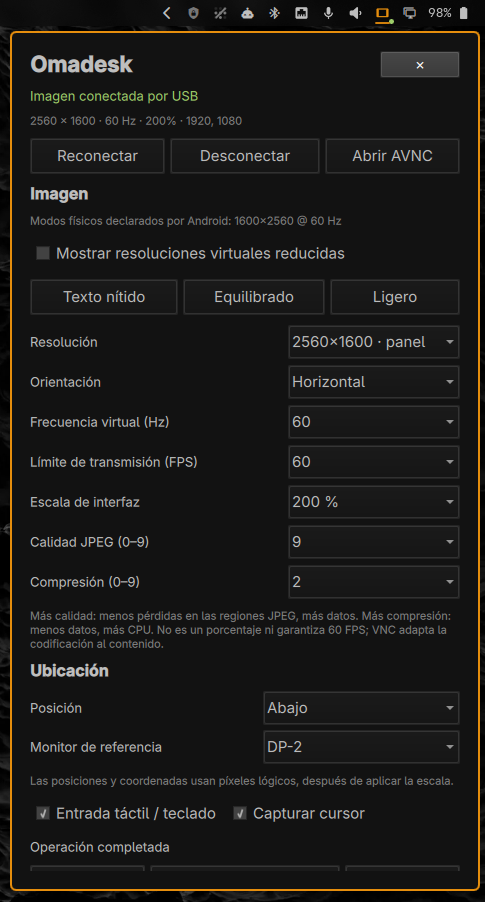

# Omadesk



**Autor:** [castarrillo](https://github.com/castarrillo) · **Licencia:** MIT ·
**ID:** `io.github.castarrillo.omadesk`

Convierte una tablet o teléfono Android en un **monitor extendido de Omarchy por
cable USB**. Incluye un plugin de barra Quickshell, un controlador de Hyprland
y un instalador que prepara el PC y el Android conectado.

No utiliza Spacedesk, Wi-Fi, drivers de Windows, root en Android ni cambios de
firmware. La imagen no es un espejo: puedes mover ventanas al monitor virtual.

## Instalación completa

Requiere una sesión de **Omarchy con Quickshell e Hyprland Lua** (`hl.monitor` y
`hyprctl eval`), acceso a Internet para las dependencias y **Android 5.0/API 21+**.
No se soportan todavía otras distribuciones, Hyprland con configuración legacy,
iOS ni todas las variantes de Android de forma garantizada.

1. En Android activa **Opciones de desarrollador → Depuración USB**.
2. Conecta un **cable de datos**, desbloquea el dispositivo y acepta la
   autorización de depuración para este ordenador. Algunos fabricantes exigen
   además permitir instalaciones por USB; el instalador no elude ese permiso.
3. Descarga e instala desde una terminal **como tu usuario**:

   ```bash
   git clone https://github.com/castarrillo/omadesk.git
   cd omadesk
   bash install.sh
   ```

Si has descargado un ZIP, descomprímelo primero. Si has clonado el repositorio,
omite `git clone` y entra en la carpeta clonada antes de ejecutar `bash install.sh`. No uses `sudo bash
install.sh`: el instalador solicita elevación solo para los paquetes del PC.

El instalador:

- Instala los paquetes Arch que falten: `android-tools`, `android-udev`, `wayvnc`,
  `python`, `jq` e `iproute2`, mediante `omarchy pkg add`.
- Instala el plugin en `~/.config/omarchy/plugins/io.github.castarrillo.omadesk/`, los comandos
  `omadesk` y `tablet-usb`, y el lanzador **Omadesk**.
- Habilita el plugin y **reinicia la shell**, para que el panel no conserve el
  título/código de una versión anterior. No cierra tus aplicaciones ni reinicia
  el ordenador; los paneles abiertos de la barra sí se cierran.
- Detecta el Android por USB. Si hay varios, exige seleccionar uno por número de
  serie; no instala aplicaciones indiscriminadamente en todos los dispositivos.
- Descarga **AVNC 3.3.1 oficial**, comprueba su SHA-256 fijado y lo instala por ADB
  **solo si AVNC no está instalado**. No reemplaza versiones existentes ni borra
  datos de la aplicación. Una versión existente incompatible puede requerir una
  actualización manual.
- Lee la resolución física y los modos de pantalla de Android; propone una
  imagen horizontal con la proporción del dispositivo, frecuencia y escala
  compatibles con los límites actuales de Omadesk.
- Conserva los ajustes existentes del mismo dispositivo. Para otro dispositivo
  guarda un respaldo antes de seleccionar y configurar el nuevo.

**La autorización USB no puede automatizarse.** Si no está autorizada o está
desconectado, la preparación termina con un mensaje claro; el plugin y los
paquetes pueden quedar ya instalados. Autoriza/conecta y repite:

```bash
omadesk setup
omadesk start
```

Si el comando no se encuentra, abre otra terminal o usa `~/.local/bin/omadesk`.

### Varios dispositivos / instalación sin Android conectado

```bash
omadesk devices
bash install.sh --serial NUMERO_DE_SERIE
bash install.sh --skip-device          # Instalar solo en el PC
omadesk setup --serial NUMERO_DE_SERIE  # Preparar Android después
omadesk setup --dry-run                # Detectar sin instalar ni guardar
omadesk setup --reset-image            # Reemplazar ajustes con los detectados
```

`setup --reset-image` cambia el archivo guardado, no reinicia una transmisión
activa. Aplica después desde el panel o con `omadesk restart`.

Puedes evitar la descarga del APK proporcionando una copia **de la misma
versión oficial**, que también se verifica:

```bash
bash install.sh --apk /ruta/AVNC-3.3.1.apk
omadesk setup --apk /ruta/AVNC-3.3.1.apk
```

APK de origen:
<https://github.com/gujjwal00/avnc/releases/tag/v3.3.1>

```text
SHA-256: 61cb507e9f334f0276eacc8e9574bae6934d18e59c96b49f900a1183637d8f88
```

El APK no se distribuye en este repositorio. AVNC es un proyecto independiente,
con su propia licencia GPL-3.0-or-later. El hash comprueba integridad respecto
del archivo fijado; no sustituye la confianza en el editor/origen del APK.

### Si instalas mediante el gestor de plugins

`omarchy plugin add https://github.com/castarrillo/omadesk --enable` **no ejecuta un instalador
arbitrario del repositorio**. Después de añadirlo, ejecuta explícitamente:

```bash
bash ~/.config/omarchy/plugins/io.github.castarrillo.omadesk/install.sh
```

Ese paso es necesario para preparar PC y Android. No se instalan paquetes ni
APKs silenciosamente cada vez que se carga o abre el panel.

## Uso del panel

Haz clic en el icono de tablet de la barra: el título debe ser **Omadesk**.

- Conectar, desconectar, reconectar y abrir AVNC.
- Resolución (incluida la nativa detectada), orientación, escala y posición.
- Modos físicos declarados por el panel Android, sin mezclar HDMI o pantallas
  virtuales cuando Android permite identificar la pantalla integrada.
- Resoluciones de transmisión virtuales reducidas opcionales, etiquetadas como
  **virtuales**, no como resoluciones físicas soportadas por el dispositivo.
- Posición relativa a un monitor concreto o coordenadas lógicas X/Y.
- Frecuencia virtual y límite independiente de FPS.
- Calidad JPEG 0–9, compresión 0–9, entrada remota y cursor.
- Presets de texto nítido, equilibrado y ligero adaptados al aspecto del panel.
- Estado real, lectura del panel Android y registro de diagnóstico.

**Guardar** conserva el borrador sin interrumpir la imagen. **Guardar y aplicar**
reinicia la conexión. Si falla, restaura el archivo anterior e intenta recuperar
la transmisión previa. No puede garantizar esa recuperación si falta el USB o
el compositor está fallando. Cambiar orientación requiere también girar el
Android/permitir su rotación automática.

## CLI

```bash
omadesk setup
omadesk start
omadesk stop
omadesk restart
omadesk status      # JSON: ajustes guardados, aplicados y monitor real
omadesk devices     # dispositivos del servidor ADB privado
omadesk viewer
omadesk detect
omadesk logs
omadesk save --settings '{"serial":"NUMERO_DE_SERIE","width":1920,"height":1200,"scale":1.25}'
```

`save`/`apply` completan campos ausentes con valores predeterminados: no son un
parche sobre el archivo anterior. El panel siempre envía el objeto completo.
El comando anterior `tablet-usb` sigue disponible como alias.

## Archivos y actualización

- Código instalado: `~/.config/omarchy/plugins/io.github.castarrillo.omadesk/`.
- Ajustes privados: `~/.config/tablet-usb/settings.json`.
- Capacidades de dispositivos: `~/.config/tablet-usb/devices.json`.
- Respaldos del instalador: `~/.local/share/omadesk/backups/`.
- Servicio transitorio: `tablet-usb.service` (nombre interno compatible).

Se respetan `XDG_CONFIG_HOME`, `XDG_DATA_HOME` y `XDG_CACHE_HOME`.
Los ajustes/números de serie no forman parte del repositorio. La identidad
interna pública es `io.github.castarrillo.omadesk`. El instalador migra los
campos de identidad de `local.tablet-usb` en la barra, conservando su ubicación,
respalda `shell.json` antes de modificarlo y deshabilita el plugin anterior.
No elimina su carpeta: puede estar siendo utilizada por una transmisión activa.
Los nombres del servicio, monitor y archivos de ajustes se conservan para mantener
la compatibilidad y no perder tus configuraciones.

Para actualizar desde un clon: `git pull` y `bash install.sh`. El instalador
respalda los archivos que reemplaza y conserva los ajustes del dispositivo.
`--no-restart` aplaza la recarga, pero deberás ejecutar después:

```bash
omarchy restart shell
```

## Arquitectura, seguridad y límites

```text
Hyprland TABLET-USB → WayVNC: $XDG_RUNTIME_DIR/omadesk/vnc.sock
                   → proxy: $XDG_RUNTIME_DIR/omadesk/quality.sock
                   → ADB privado: $XDG_RUNTIME_DIR/omadesk/adb.sock
                   → USB → 127.0.0.1:5909 en Android → AVNC
```

Desde **v1.2.3 no hay listeners VNC TCP en el PC**, ni siquiera en loopback.
VNC, el proxy y ADB utilizan sockets Unix de filesystem dentro de un directorio
0700 propiedad del usuario. El proxy verifica también el UID del cliente con
`SO_PEERCRED`. Se rechazan directorios con permisos de grupo/otros o symlinks;
no hay fallback a TCP ni sockets abstractos.

El servidor ADB se selecciona explícitamente con `-L localfilesystem:...` para
cada operación. No se usa el servidor TCP compartido 5037. Si existe uno de esa
misma cuenta, Omadesk se niega a iniciar o termina la transmisión al detectarlo
en su siguiente operación ADB: ese servidor podría actuar como proxy privilegiado
para otros usuarios locales. **No abras Android Studio/scrcpy u otras herramientas
que vuelvan a iniciar un ADB compartido de la misma cuenta mientras usas Omadesk.**
La supervisión no es un mecanismo instantáneo de contención frente a otros
servidores inseguros iniciados por programas de tu propia cuenta. Para migrar:

```bash
omadesk stop
# Cierra las herramientas que usan el ADB compartido; esto las desconecta:
adb kill-server
omadesk devices  # usa únicamente ADB privado
omadesk start
```

No se desactiva automáticamente el servidor ADB de otras herramientas. Si una
de ellas necesita acceso simultáneo, configúrala explícitamente para utilizar
el mismo socket ADB privado en vez de crear un listener TCP, o no las uses a la vez.
El puerto 5909 permanece **solo dentro del Android autorizado**, que se considera
un dispositivo de confianza: otras apps de ese Android podrían acceder a su
loopback. No protege contra root, procesos del mismo UID, una cuenta propietaria
comprometida ni servicios ajenos que expongan sus privilegios a otros usuarios.

`-C /dev/null` selecciona una configuración dedicada de WayVNC, no una excepción
de autenticación sobre un puerto público: el transporte se restringe mediante
permisos Unix y UID. No se habilita ADB inalámbrico. Consulta [SECURITY.md](SECURITY.md).

La frecuencia física se obtiene de `dumpsys display` cuando Android la informa.
Si no, se indica que se ha usado una propuesta de 60 Hz; no es una medición.
La propuesta usa hasta **120 Hz virtuales**, **60 FPS de transmisión**, dimensiones
pares de hasta 4096 y un máximo de 8 847 360 píxeles. En paneles mayores se reduce
la resolución manteniendo aproximadamente su proporción. No se cambia la
frecuencia física del Android ni se garantiza que cualquier combinación funcione.

La escala debe producir dimensiones lógicas enteras. Calidad 9 no significa
sin pérdidas: afecta a las regiones JPEG de Tight, mientras otras regiones
pueden usar codificación sin pérdidas. La compresión es una preferencia, no un
bitrate garantizado. **60 FPS configurados no garantizan 60 FPS sostenidos.**
VNC es adecuado para productividad, no promete rendimiento de monitor nativo
para juegos/vídeo. No hay audio, presión de lápiz ni multitáctil nativo.

Las escalas del panel son **100 %, 125 %, 150 % y 200 %**. 150 % requiere una
resolución divisible por 1.5: 1920×1200 funciona, pero 2560×1600 no. Cambiar a
una resolución incompatible selecciona automáticamente una escala válida;
seleccionar manualmente una escala incompatible muestra un aviso sin aplicarla.
La configuración automática prefiere 150 % cuando es compatible; si no, utiliza
125 % o 100 %. Las configuraciones antiguas al 160 % siguen siendo legibles
por compatibilidad, pero esa opción ya no se ofrece en el panel.

`omadesk detect` vuelve a consultar y guardar los modos del Android. También se
consultan al iniciar una nueva conexión. El panel muestra **lo que Android
declara**, no una lista universal de modos inventados. Si no declara modos,
se señala que faltan por confirmar; no se garantiza compatibilidad con todo
fabricante, ROM o versión de Android.

El servicio termina al desconectar USB y retira su monitor virtual. No se añade
arranque automático al iniciar sesión. Cerrar AVNC no retira el monitor: usa
**Desconectar** o `omadesk stop`.

### Mantener imagen y posición al cambiar las pantallas del portátil

Durante una conexión, Omadesk conserva una instantánea de la resolución,
frecuencia, escala, orientación y posición aplicada. Comprueba su monitor
virtual cada dos segundos y, si Hyprland lo restablece al recargar o al
activar/desactivar otras pantallas, vuelve a aplicar esa instantánea.
No modifica los monitores físicos ni necesita reiniciar AVNC.

Las posiciones relativas se calculan una vez al conectar y después se fijan:
un cambio en la pantalla del portátil no recoloca la tablet. Para recalcular
la posición relativa, usa Reconectar o Guardar y aplicar. Guardar ajustes sin
aplicarlos no cambia la instantánea que se mantiene durante la conexión.
Puede verse un cambio transitorio hasta la siguiente comprobación; esto no
evita el restablecimiento interno de Hyprland, sino que lo corrige.

## Pruebas y problemas frecuentes

```bash
/usr/bin/python -m unittest discover -s tests -v
qmllint -I /usr/share/omarchy/shell Main.qml
omarchy plugin validate .
journalctl --user -u tablet-usb.service -n 50 --no-pager
```

- **Título antiguo:** guarda tu borrador y ejecuta `omarchy restart shell`.
- **unauthorized:** desbloquea Android y acepta la huella del PC.
- **no permissions:** tras instalar `android-udev`, vuelve a conectar el USB;
  puede ser necesario cerrar sesión/volver a entrar por las reglas de acceso.
- **Varios Android:** selecciona uno con `--serial`.
- **Instalación USB rechazada:** confirma la solicitud de seguridad del fabricante.
- **Modo/escala rechazado:** usa escala 100 % o una resolución menor.
- **Fallo de captura:** se requiere una versión compatible de Hyprland/WayVNC.

Solo se ha probado físicamente con la Huawei MRX-W09 de desarrollo. La detección
de otros tamaños, varios dispositivos, errores y negociación RFB tiene pruebas
automatizadas, no una certificación de todos los teléfonos Android.

## Desinstalación

Para ocultar solo el icono:

```bash
omarchy plugin disable io.github.castarrillo.omadesk
```

Esto no detiene la transmisión: usa `omadesk stop`.

Para retirar el plugin, sus comandos propios y el lanzador:

```bash
/usr/bin/python ~/.config/omarchy/plugins/io.github.castarrillo.omadesk/uninstall.py
# Lee el aviso y confirma explícitamente:
/usr/bin/python ~/.config/omarchy/plugins/io.github.castarrillo.omadesk/uninstall.py --yes
```

El desinstalador respalda el código y los lanzadores, detiene la transmisión y
delega la retirada del plugin al gestor de Omarchy. Conserva tus ajustes de
`~/.config/tablet-usb/`, los respaldos, AVNC y los paquetes del sistema, que pueden
ser utilizados por otros programas. AVNC se puede desinstalar desde Android si
ya no lo necesitas. Una carpeta antigua `local.tablet-usb` se conserva deshabilitada;
puede retirarse posteriormente desde el gestor una vez comprobada la migración.

## Publicar un clon local en GitHub

Si el repositorio aún no tiene remoto y tienes GitHub CLI:

```bash
gh auth login
gh repo create omadesk --public --source=. --remote=origin --push
```

Comprueba el contenido antes de publicar. No subas ajustes personales, APKs,
credenciales ni capturas con información privada.
